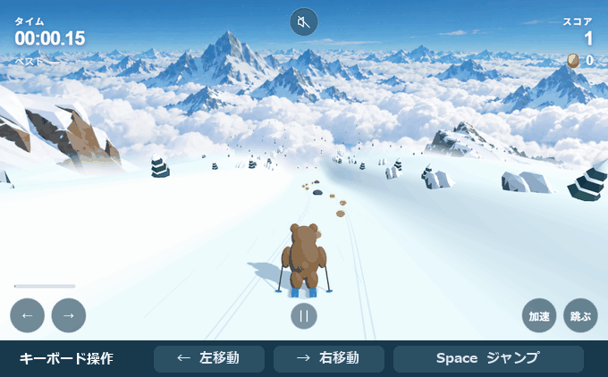
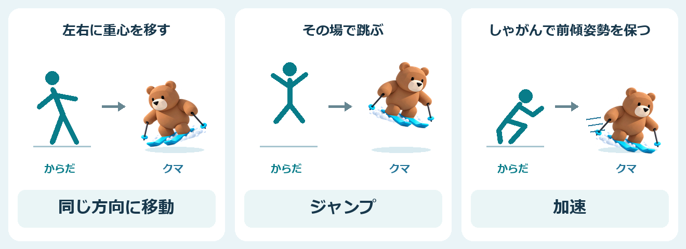

# Be The Bear

カメラの前で体を動かして、スキーをするクマと一緒に1,500mの雪山を滑るブラウザーゲームです。コインを集め、ジャンプ台では空中のお金の袋を狙いましょう。

**[Be The Bear を遊ぶ](https://be-the-bear.kait0.workers.dev/)**

## 制作について

- **制作体制**　JOGIHACK 2026で、チーム「しゃりしゃり」の2人で14日間かけて開発しました。
- **自分の担当**　公開準備では、初めて遊ぶ人を想定して検証項目を決めました。ゲストで完走し、ページを再読み込みしてもベストタイムが残るところまでを、提出前の確認範囲にしました。
- **技術的な工夫**　体格や立ち位置の違いに合わせるため、チームではプレイ開始時の立ち姿を操作の基準にしました。滑走中に姿勢を見失ったときは古い入力を止め、姿勢を合わせ直すと同じ滑走を続けられます。

## 遊び方

タイトル画面からロビーに進み、**PLAY** で操作方法を選びます。身体操作では、カメラに正面を向き、頭から足先まで映してスキャンを完了させます。キーボードでもプレイできます。

| クマの動き | 身体操作 | キーボード |
| --- | --- | --- |
| 左右に移動 | 重心を行きたい方向へ移す。体を中央に戻すと、その横位置で止まる | ← / → または A / D |
| ジャンプ | その場で跳ぶ | Space または ↑ |
| 加速 | しゃがんで前傾姿勢を保つ | ↓ または S を押し続ける |
| 一時停止 | 画面の一時停止ボタンを押す | Esc |

タッチボタンでも左右移動・ジャンプ・加速ができます。集めたコインはロビーの **SHOP** でマフラーと交換できます。

## プロジェクト資料

[設計概要](docs/architecture.md) · [素材・ライセンス](docs/assets.md)
