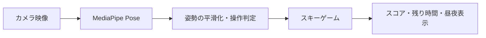

# Bear Ski（仮）

MediaPipeでプレイヤーの全身を認識し、身体の動きでスキーヤーを操作するブラウザーゲーム。

## コンセプト

プレイヤーはPCカメラの前で正面を向き、画面内の熊スキーヤーを後ろから見ながら操作する。プレイヤーの姿勢をゲーム内の熊の動きにも反映し、急な雪山のコースを滑る一体感を作る。左右にターンし、ジャンプで障害物を越え、しゃがんで前傾姿勢を保つことで加速する。1プレイ3分を滑りきり、スコアを競う。

## 想定ユーザーと利用環境

- 1人プレイ
- PCのブラウザーとカメラを使用
- アプリのインストール不要
- プレイヤー本人はカメラに正面を向き、頭から足まで画面に入る
- 音声操作なし

## ゲームの流れ

1. カメラを許可し、全身が認識されていることを確認する
2. 基準姿勢をキャリブレーションする
3. 3分間のスキーコースを滑走する
4. 身体を左右に動かしてターンし、ジャンプで障害物や段差を越える
5. しゃがんで前傾姿勢を保ち、タック姿勢で加速する
6. アイテムを集めながらゴールを目指す
7. 残り時間が0になると結果を表示する

## 操作案

| プレイヤーの動き | ゲーム内の操作 |
|---|---|
| 腰・上半身を左へ移動／傾ける | 左へターン。熊の上体も左へ傾き、スキー板をターン方向へ傾ける |
| 腰・上半身を右へ移動／傾ける | 右へターン。熊の上体も右へ傾き、スキー板をターン方向へ傾ける |
| その場でジャンプする | 熊が沈み込みから踏み切り、空中姿勢を取り、着地で膝を曲げる |
| しゃがんで前傾姿勢を保つ | 熊が低いタック姿勢になり、加速する |
| 直立に戻る | 熊が通常滑走の姿勢に戻る |

MediaPipeで認識した姿勢はゲーム操作だけでなく、熊の上体・脚・スキー板のアニメーションにも連続的に反映する。加速中は速度が徐々に上がり、タックをやめると通常速度へ戻る想定。しゃがみは加速に使うため、低い障害物をくぐる操作とは分ける。

### 姿勢入力と熊のアニメーション

| 認識する動き | ゲームへの反映 | 熊の見た目の変化 |
|---|---|---|
| 左右への重心移動・上体の傾き | 横移動とターン量 | 肩・胴体が同じ方向へ傾き、膝とスキー板もターンに合わせて傾く |
| ジャンプの立ち上がり | ジャンプ開始 | 熊が一度沈み込んでから踏み切り、空中では腕と脚を少し広げる |
| 着地 | ジャンプ終了 | 膝を曲げて衝撃を吸収し、雪しぶきを出す |
| しゃがみ＋前傾 | 加速 | 背中を低くし、腕を後ろに引くタック姿勢になる |
| 姿勢が取れない | 操作を弱め、安全な通常滑走へ戻す | 熊も通常姿勢に戻し、画面に全身を映す案内を出す |

姿勢入力は基準姿勢からの相対変化として扱い、ランドマークの揺れを平滑化する。左右操作にはデッドゾーンを設け、姿勢が境界付近で揺れても熊やターンが細かく振動しないようにする。ジャンプは一瞬の誤検出で連発しないよう、踏み切りと着地を状態として管理する。

## 3分間の時間変化

- 1プレイは3分
- 開始時は昼、プレイの経過に合わせて夕方から夜へ変化する
- 画面にスコアと残り時間を常に表示する
- HUD案：残り時間は左上、スコアは右上
- コースは滑走に合わせて景観を循環表示し、3分で結果画面へ進む

## ビジュアル方針

参考画像の「後ろから追うカメラ」「雪山を滑る爽快感」「シンプルなローポリ調」は参考にする。一方、既存画像の再現にならないよう、コースの形・背景・キャラクター・HUD配置を独自に設計する。

- ビジュアル比率は「ローポリ9：リアル1」。地形・木・キャラクターは明確なローポリ形状にし、雪面の質感・スキー跡・光と影だけを少しリアルにする
- 急斜面、連続するカーブ、雪しぶきでスピード感を出す
- 広く平らな雪原中心の構図ではなく、急なS字コースが続く山あいの斜面にする
- 昼から夜への変化を、空・雪面・コース上の光で見せる
- 昼の雪山と夜のゲレンデを同じコース内でつなぐ
- カラフルなスノーパークは初期案から除外する
- タイマーは左上、スコアは右上に置き、参考画像とHUDの配置を変える
- 主人公は服や帽子などを身につけない熊。自然な茶色の毛並みと、後ろ姿でも分かる丸い耳・体のシルエットで表現する
- 熊の姿勢アニメーションをプレイヤーのMediaPipe入力と同期し、操作の手応えが画面から伝わるようにする
- 参考画像のように、広い雪面・青い夜空・オーロラ・少数のローポリの木でシンプルにまとめる。形状やキャラクターは独自にする

## MVP（最初に完成させる範囲）

- 1つの急斜面コースと3分間の滑走結果
- MediaPipeによるリアルタイムの全身姿勢推定
- 左右ターン、ジャンプ、タック加速
- コース上の障害物・段差・アイテム
- スタート画面、プレイ画面、結果画面
- 3分の残り時間表示とスコア表示
- 昼から夜への時間変化
- 姿勢が認識できているかを示す案内

## 技術・設計方針（仮）

- Webアプリとしてブラウザー上で動作
- MediaPipe Pose Landmarkerでカメラ映像から全身ランドマークを取得
- ランドマークの揺れを平滑化し、キャリブレーション後の身体の動きから操作量を計算
- 映像認識とゲーム処理を分け、ゲーム側には左右・ジャンプ・加速などの操作状態を渡す
- 描画はThree.js、開発・ビルドはVite、公開はSitesの静的ホスティングを使用する



## 初期版の対象外

- 複数人プレイ
- 音声操作
- 追加学習や行動予測
- コースの自動生成

## 未決定事項

- 正式なアプリ名
- 3分コース内の具体的な障害物配置とスコア計算

## 開発期間

約1か月。

## 実装済みアプリ

- Three.js / Vite / MediaPipe Pose Landmarker（Lite）
- 服を着ていないローポリの熊と、身体に連動する姿勢アニメーション
- カメラの全身確認 → 全身が映り、まっすぐ立った姿勢が3秒間安定すると自動で基準姿勢を調整 → 3秒カウントダウン
- キーボード: ← → / A D で移動、Space / ↑ でジャンプ、↓ / S でタック加速、Escで一時停止
- タッチ操作ボタンも用意
- プレイ時間は3分固定。昼・夕方・オーロラの夜へ変化
- 得点: 滑走1mにつき0.3点、クリスタル100点、着地20点、岩に衝突すると50点減点と減速
- 姿勢を1.5秒見失った場合やタブ切り替え時は一時停止
- カメラ映像はブラウザー内で処理し、サーバーへ送信しない
- 認識モデルとWASMを同梱。フォントのみGoogle Fontsから取得

### 開発

```sh
npm install
npm run dev
```

### ビルド

```sh
npm run build
```

`dist/` をHTTPS対応の静的ホスティングへ配置する。カメラはHTTPSまたはlocalhostが必要。

### 検証上の制限

実際の人の姿勢、部屋の明るさ、カメラ位置による認識精度は実機で調整する。正面カメラによる前傾量は推定値のため、体格や設置角度に応じた調整が必要。

### 同梱ソフトウェア

Three.js 0.170.0（MIT）、MediaPipe Tasks Vision 0.10.18（Apache-2.0）とPose Landmarker Liteモデルを使用。

WebGLが使えない環境には同じゲーム形状を使うCanvas描画を用意。軽量表示では木や雪面の分割数を減らす。

姿勢合わせのボタン操作は不要。移動中・膝を曲げた状態・全身が映らない状態では計測をやり直す。スタート前のカウントダウン中に姿勢を見失った場合も、自動姿勢合わせへ戻る。
