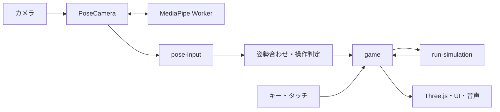
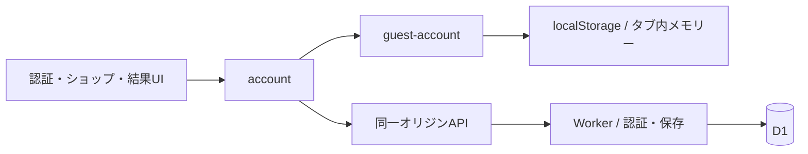

# Be The Bear：設計概要

## 構成

フロントはJavaScript ES ModulesとHTML/CSS、描画は同梱Three.jsを使用します。身体認識はMediaPipe Tasks VisionのPoseLandmarkerを専用Workerで実行します。音はWeb Audioで生成します。タイトル・ロビーは背景・クマ・小屋・ロゴの画像レイヤーと独立した操作UIを組み合わせます。タイトルでは素材の読み込み中・失敗時も旧3D画面を描画せず、水色の初期背景を保ちます。全素材のデコードと配置が完了してからタイトルを表示します。

認証付き構成ではCloudflare Workerが画面と同一オリジンのAPIを配信し、D1にアカウントと記録を保存します。Vite単独ではゲストとして動作します。

## 責務と状態

| モジュール | 責務 |
|---|---|
| web/game.js | 画面遷移、入力の受け渡し、フレーム更新、完走記録の確定・保存開始 |
| run-simulation / course / ramps / jump-flight / collectibles | 滑走状態、コース・台・飛行・取得・衝突・完走。描画や通信から分離 |
| pose-camera / public/pose-worker | カメラとWorkerの開始・停止、推論、フレームの鮮度 |
| pose-input / auto-calibration / body-control | 骨格の変換、基準姿勢の確定、操作判定 |
| ski-world / course-surface / finish-line / resort-scene | Three.jsの描画、雪面、ゴール、終着エリア |
| menu-art / menu-scene / title-scene / lobby-actions | メニュー画像・代替3D構図、見た目に対応する操作領域、ボタン配置 |
| game-ui / auth-ui / shop-view / i18n / translations | 画面、認証フォーム、ショップ、共通翻訳 |
| sound / preferences | 音声ノードと設定。ショップの表示1回につき扉音を1回再生 |
| account / auth-request / guest-account | アカウント状態、通信、保存の直列化、ゲスト保存 |
| worker/index / game-auth / account-api | ルーティング、認証・セッション、記録・購入処理 |
| db / drizzle | スキーマ定義と移行SQL |

画面状態はgame、数値の滑走状態はsimulation、メッシュ・カメラはworldが所有します。取得物は配置とcollectedを共有するレコードで管理し、描画と取得判定の位置を一致させます。各ジャンプ台の袋は3個、横位置−13/0/＋13mで、1袋10コインです。

## 入力から描画

- 推論は同時に1フレームとし、古いフレームをキューへ積みません。GPUを初期値とし、CPU切替・復旧経路を備えます。
- 骨格は画像の正規化座標から操作用の測定値へ変換します。正面カメラの左右反転は入力変換で扱います。
- 入力はsteer（−1〜1）、tuck（0〜1）、有効性とジャンプ要求へ変換します。姿勢合わせ中はゲーム操作へ反映しません。
- 基準姿勢は新しい有効フレームと安定性から確定します。未検出・古い認識結果では入力を止め、再スキャン後は同じ滑走を再開します。
- 距離・高さはm、速度はm/s、シミュレーションの時間は秒です。描画はahead=along−distance、z=−aheadとして前方を表します。
- ジャンプの高さは描画と衝突・取得で共通です。完走は1,500mで記録を確定し、祝い演出中の移動や入力で報酬を変更しません。
- 画像追跡は比較用の実験機能であり、通常のジャンプ判定には使用しません。

## 認証と保存

主なAPIは/api/auth/session、register、login、recover、logout、availabilityと、/api/profile、run、purchase、equipです。登録IDの補助確認は登録の代わりにはせず、登録時にも入力検証とDB一意制約を適用します。

Profileはcoins、owned、equipped、bestMs、courseIdを持ちます。完走記録は{runId,courseId,coins,timeMs}として確定し、同じrunIdの再送で二重加算しません。保存時にアカウントの一致も照合します。

パスワードはscryptでハッシュ化し、セッションはSecure・HttpOnly・SameSite=StrictのCookieを使います。試行回数・入力サイズを制限し、復旧時は旧コード・旧セッションを失効させます。

D1はprofiles、runs、game_users、game_sessions、game_auth_limits、game_legacy_claimsを使用します。ゲストはブラウザー内に別途保存し、登録記録と自動合算しません。保存キーと既存アカウントの互換性を維持します。

## ライフサイクルと設計理由

初期HTMLの`menu-pending`はゲーム表示を隠し、正式メニューと同じ背景色（#bfe8ff）を表示します。game-uiは最初から正式なPNGロゴを参照します。menu-artがメニュー画像と表示するロゴの読み込み・decodeを待ち、gameの描画フレームで画像と操作領域を配置してから表示と開始入力を解放します。固定時間での切り替えは行いません。画像の取得・decodeに失敗した場合も旧3Dタイトルや旧SVGロゴを表示せず背景色を維持します。再試行はページの再読み込みで行います。

カメラ停止時はトラック・Worker・タイマーを解放し、古い非同期応答を無効化します。一時停止中は数値更新と滑走音を止めます。リトライでは同じアプリインスタンスを使い、取得状態・飛行・演出をリセットします。ページ終了時にはカメラ、実験Worker、音声、完走パーティクルを終了します。

ゲーム計算を描画・通信から分離することで、カメラなしの合成入力でも判定を検証できる構成です。既存のJavaScriptと小さなモジュールを使い、別のフレームワークや状態管理基盤は導入していません。UIを変更しても認証・保存の確定処理へ影響しない境界を設けています。

## 提出用ビルド

Viteでdist/clientとdist/server/index.jsを生成します。公開サービス固有のホスティングメタデータは不要なためコピーしません。D1の移行はdrizzle/を参照します。dev:authは別のローカル専用設定を作成し、本番DBを使いません。提出用の整理ではゲームコード・API・DB定義を変更していません。

起動方法は[README](../README.md)を参照してください。

## タイトル初期表示の検証（2026-10-16）

- `npm.cmd test`：274件成功。画像の未読込・キャッシュ済み・decode待機・失敗、準備前の開始入力、既存のゲーム・保存処理を含みます。
- `npm.cmd run build`：成功。500 kB超のチャンク警告あり。ローカルのdistを再生成しました。
- ローカルVite＋ヘッドレスChrome：PC（1440×900）、スマートフォンの表示・タッチエミュレーション（390×844、844×390）で通常表示、再読み込み、キャッシュ無効、低速通信（遅延200 ms、下り1 MiB/s）を確認。描画フレームごとに、準備中の非表示と背景色、表示時の画像decode完了・配置を検査し、旧タイトルの露出はありませんでした。
- 正式画面は従来のロゴ差し替え経路と比較し、点滅アニメーションを同じ時点に揃えた3サイズのスクリーンショットがピクセル一致。四隅・中央のクリック／タップ、Enter開始、ショップ、キーボード操作でのゲーム開始・一時停止・ロビー復帰も確認しました。
- CSSやロゴの読み込みを意図的に保留した場合は背景色だけを表示し、ロゴ取得失敗でも旧タイトルを表示しないことを確認しました。

実スマートフォン、Safari、実カメラ、実Worker・D1、公開環境は未確認です。実機ではキャッシュを消して低速回線で再読み込みし、縦横それぞれで背景色から正式画面へ切り替わること、画面端からロビーへ進めること、ショップとカメラ操作でのゲーム開始・復帰を確認してください。公開・コミット・プッシュは行っていません。
