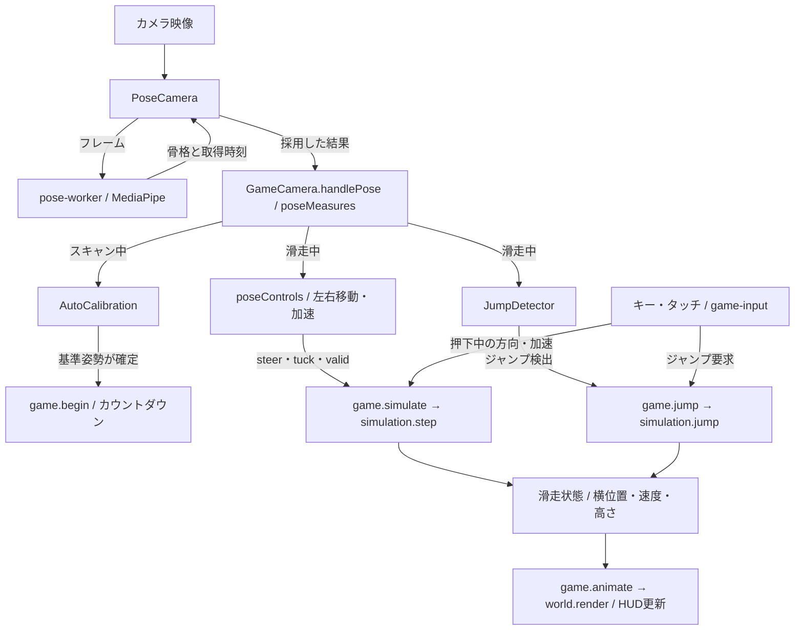
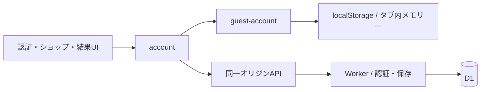

# Be The Bear：設計概要

## 構成

フロントはJavaScript ES ModulesとHTML/CSS、描画は同梱Three.jsを使用します。身体認識はMediaPipe Tasks VisionのPoseLandmarkerを専用Workerで実行します。音はWeb Audioで生成します。タイトル・ロビーは背景・クマ・小屋・ロゴの画像レイヤーと独立した操作UIを組み合わせます。タイトルでは素材の読み込み中・失敗時も旧3D画面を描画せず、水色の初期背景を保ちます。全素材のデコードと配置が完了してからタイトルを表示します。

認証付き構成ではCloudflare Workerが画面と同一オリジンのAPIを配信し、D1にアカウントと記録を保存します。Vite単独ではゲストとして動作します。

## 責務と状態

| モジュール | 責務 |
|---|---|
| [game.js](../web/game.js) | 画面と操作モードを管理する。入力を滑走計算へ渡し、結果を描画・HUDに反映して、完走時に記録を確定する |
| [game-input.js](../web/game-input.js) | キー・タッチの押下と解放を処理し、押下中のキーを更新する。画面に応じてジャンプや一時停止を要求する |
| [game-camera.js](../web/game-camera.js) | 身体操作のセッションを管理する。スキャン中は基準姿勢を集め、滑走中は姿勢から左右移動・加速を更新し、ジャンプを要求する |
| [motion-check.js](../web/motion-check.js) / [pose-recording.js](../web/pose-recording.js) / [motion-experiment.js](../web/motion-experiment.js) | 「動きの確認」画面、骨格の記録・再生比較、実験用の画像追跡をそれぞれ担当する |
| run-simulation / course / ramps / jump-flight / collectibles | 滑走状態、コース・台・飛行・取得・衝突・完走。描画や通信から分離 |
| [pose-camera.js](../web/pose-camera.js) / [public/pose-worker.js](../web/public/pose-worker.js) | PoseCameraが映像トラックと推論Workerを起動・解放し、結果の鮮度を確認する。WorkerはMediaPipeでフレームから骨格を推定する |
| [pose-input.js](../web/pose-input.js) / [auto-calibration.js](../web/auto-calibration.js) / [body-control.js](../web/body-control.js) | 骨格の測定・操作量への変換、安定した基準姿勢の確定、ジャンプの判定をそれぞれ担当する |
| ski-world / course-surface / finish-line / resort-scene | Three.jsの描画、雪面、ゴール、終着エリア |
| menu-art / menu-scene / title-scene / lobby-actions | メニュー画像・代替3D構図、見た目に対応する操作領域、ボタン配置 |
| game-ui / auth-ui / shop-view / i18n / translations | 画面、認証フォーム、ショップ、共通翻訳 |
| sound / preferences | 音声ノードと設定。ショップの表示1回につき扉音を1回再生 |
| account / auth-request / guest-account | アカウント状態、通信、保存の直列化、ゲスト保存 |
| worker/index / game-auth / account-api | ルーティング、認証・セッション、記録・購入処理 |
| db / drizzle | スキーマ定義と移行SQL |

画面状態はgame、数値の滑走状態はsimulation、メッシュと描画用の3Dカメラはworldが所有します。取得物は配置とcollectedを共有するレコードで管理し、描画と取得判定の位置を一致させます。各ジャンプ台の袋は3個、横位置−13/0/＋13mで、1袋10コインです。

## 入力から描画

### 身体操作をコードとテストでたどる

| 場面 | 処理 | 実装 | 対応するテスト |
|---|---|---|---|
| 映像を受け取る | 取得時刻から250ms以内で、前回より新しい推論結果をゲームへ渡す。 | [結果の採用条件](../web/pose-camera.js#L51) | [古い結果と停止後の応答](../tests/pose-camera.test.js#L17) |
| 姿勢を合わせる | 全身が映った安定サンプルから基準姿勢を確定する。スキャン中の動きでクマが跳ぶことはない。 | [collectCalibration](../web/game-camera.js#L187) | [重複フレームとスキャン完了](../tests/run.test.js#L200) |
| 左右移動・加速 | 基準姿勢に対する重心移動と前傾から操作量を求める。次の物理更新で横位置と速度が変わり、体を中央に戻すとその横位置で止まる。 | [poseControls](../web/pose-input.js#L45) → [simulate](../web/game.js#L259) → [横位置の更新](../web/run-simulation.js#L117) | [左右の向き・停止・加速](../tests/run.test.js#L333) |
| ジャンプ | 骨格サンプルを受け取った時点でジャンプを判定し、成立すれば飛行を開始する。次の描画では更新した高さを使う。 | [applyControls](../web/game-camera.js#L214) | [離陸判定から次の描画まで](../tests/run.test.js#L54) |
| 追跡を失ったとき | 最後の有効姿勢から350msを超えると操作量をクリアする。滑走中に1,500msを超えると再スキャンし、同じ滑走を再開する。 | [フレームごとの鮮度確認](../web/game.js#L278) | [距離・コインを保った再開](../tests/run.test.js#L40) |

- 距離・高さはm、速度はm/s、シミュレーションの時間は秒です。描画はahead=along−distance、z=−aheadとして前方を表します。
- ジャンプの高さは描画と衝突・取得で共通です。完走は1,500mで記録を確定し、祝い演出中の移動や入力で報酬を変更しません。
- 画像追跡は比較用の実験機能であり、通常のジャンプ判定には使用しません。

## 認証と保存

主なAPIは/api/auth/session、register、login、recover、logout、availabilityと、/api/profile、run、purchase、equipです。登録IDの補助確認は登録の代わりにはせず、登録時にも入力検証とDB一意制約を適用します。

Profileはcoins、owned、equipped、bestMs、courseIdを持ちます。完走記録は{runId,courseId,coins,timeMs}として確定し、同じrunIdの再送で二重加算しません。保存時にアカウントの一致も照合します。

パスワードはscryptでハッシュ化し、セッションはSecure・HttpOnly・SameSite=StrictのCookieを使います。試行回数・入力サイズを制限し、復旧時は旧コード・旧セッションを失効させます。

D1はprofiles、runs、game_users、game_sessions、game_auth_limits、game_legacy_claimsを使用します。ゲストはブラウザー内に別途保存し、登録記録と自動合算しません。保存キーと既存アカウントの互換性を維持します。

## ライフサイクルと設計理由

初期HTMLの`menu-pending`はゲーム表示を隠し、正式メニューと同じ背景色（#bfe8ff）を表示します。game-uiは最初から正式なPNGロゴを参照します。menu-artがメニュー画像と表示するロゴの読み込み・decodeを待ち、gameの描画フレームで画像と操作領域を配置してから表示と開始入力を解放します。固定時間での切り替えは行いません。読み込み中は進行中の案内と再読み込みリンクを表示します。画像の取得・decodeに失敗した場合はエラーを案内し、再読み込みから復帰できます。全素材の準備と配置が完了すると案内を隠して開始入力を解放します。

カメラ停止時はトラック・Worker・タイマーを解放し、古い非同期応答を無効化します。一時停止中は数値更新と滑走音を止めます。リトライでは同じアプリインスタンスを使い、取得状態・飛行・演出をリセットします。ページ終了時にはカメラ、実験Worker、音声、完走パーティクルを終了します。

ゲーム計算を描画・通信から分離することで、カメラなしの合成入力でも判定を検証できる構成です。既存のJavaScriptと小さなモジュールを使い、別のフレームワークや状態管理基盤は導入していません。UIを変更しても認証・保存の確定処理へ影響しない境界を設けています。

## ビルドと公開構成

Viteで画面を `dist/client/`、Workerを `dist/server/index.js` に生成します。ビルドコマンドは `npm.cmd run build`、自動テストは `npm.cmd test` です。Workerのビルド設定とライセンスの配置は [worker-bundle.mjs](../scripts/worker-bundle.mjs) にまとめています。

D1の移行SQLは [drizzle/](../drizzle/) にあります。[wrangler.jsonc](../wrangler.jsonc) はD1のIDがダミーの設定例です。公開時には配信先のWorkerと既存D1に対応した設定を使います。`dev:auth` は専用のローカル設定とD1を作成します。

プレイ先と操作方法は [README](../README.md) に記載しています。

## 現在の確認状況（2026-11-19）

- GitHubと手元の `main` は、調査時点で `ff7d29d` に一致し、作業ツリーはクリーンでした。
- 初回調査時の公開Workerは `3e94cdd` のゲームコードを配信し、Chromeが取得したJavaScriptのSHA-256は手元のビルドと一致しました。その後、タイトル読み込みの案内を追加した `f666064` を公開Workerへ反映しました。
- 新規のChromeセッションで、ゲストのキーボード操作による1,500mの完走を確認しました。完走タイムは **00:35.21**、獲得コインは **6枚** で、ページ再読み込み後もロビーのベストタイムと所持コインが一致しました。[公開版](https://be-the-bear.kait0.workers.dev/)
- `npm.cmd test` は **277件すべて成功**しました。`npm.cmd run build` も成功し、フロントエンドの生成ファイルが500 kBを超えるサイズ警告が出ています。

### 登録アカウントの確認（2026-11-19）

公開版の画面から検証用アカウントを登録し、キーボード操作で1,500mを完走しました。結果は **00:34.76・4コイン** で、登録アカウントへの保存が成功しました。

ログアウト後、Cookieとブラウザー内保存を引き継がない新しいChromeセッションで再ログインし、ロビーに同じベストタイムと所持コインが表示されることを確認しました。その後のページ再読み込みでも両方が一致しました。

登録APIはHTTP 201、滑走記録の保存・ログイン・プロフィール取得・ログアウトの各APIはHTTP 200でした。検証終了後はログアウトしています。検証用アカウント1件と滑走記録は本番DBに残っています。

### スマートフォン表示・タッチ操作の確認（2026-11-19）

公開版をPC上のChromeのモバイル表示・タッチ入力エミュレーションで確認しました。画面サイズはCSSピクセルで指定し、縦・横それぞれ新しいブラウザーセッションでゲストとして開始しました。

| 表示 | 画面サイズ | 完走タイム | 獲得コイン | 再読み込み後 |
|---|---|---|---|---|
| 縦画面 | 390×844 | 00:37.06 | 7枚 | ベストタイム・所持コインが一致 |
| 横画面 | 844×390 | 00:37.37 | 8枚 | ベストタイム・所持コインが一致 |

タイトルから操作方法を選び、画面のタッチボタンで左右移動・ジャンプ・加速の長押し、一時停止・再開、1,500mの完走まで確認しました。主要ボタンの表示位置とタップ可能範囲を検査し、滑走画面・結果画面などの画像も確認しました。横画面の一時停止パネルでは、下部のボタンをパネル内のスクロールで表示できます。

完走・保存の検証中にJavaScriptの実行エラーは検出されず、今回の確認範囲でコード修正を要する問題は見つかりませんでした。初回のページ読み込みと横画面のタイトル準備待ちではタイムアウトが発生しましたが、再試行で完了しました。当時の通信ログがないため、そのタイムアウトの直接原因は未特定です。後日の調査では、縦横各2回の新規セッションで2.4〜2.9秒で開始でき、通信エラーは再現しませんでした。一方、画像の取得・デコードに失敗すると背景だけの画面で待ち続ける経路が見つかったため、読み込み案内・失敗表示・再読み込みリンクを追加しました。

修正公開後も、縦横各2回の新規Chromeセッションで通常のタイトル準備が2.6〜3.3秒で完了し、通信・JavaScriptエラーはありませんでした。また、ブラウザー側でロゴ取得を意図的に失敗させ、縦横ともエラー案内と再読み込みリンクの表示を確認しました。失敗条件を解除してリンクをタップするとタイトルへ復帰し、タッチ操作で滑走を開始できました。この再確認は起動・復帰経路を対象とし、完走・記録保存の結果は上記の修正前の検証です。

この検証で確認した環境はChromeのエミュレーションです。実スマートフォンでの表示・タッチ操作、Safari、実カメラによる身体操作は引き続き確認待ちです。

### 提出版の通し確認（2026-11-19）

提出版はタグ `submission-2026-11-19` で固定します。検証開始時のmainは `4c4e17e` で、公開コードの `f666064` との差分はREADMEと設計資料のみです。公開Workerは `98375077-78d8-49f9-9cef-0f29c8fd1606` を100%配信しています。Chromeが取得した `/assets/index-COZCsvfy.js` のSHA-256は `fbc6aee52e8b80a4e331bdcef629cdeb507a1247da756a25a51bf4b883075f21` で、手元のビルドと一致しました。

PC上のChrome（1280×800、新規ゲスト）で、タイトルからキーボード操作の左右移動・ジャンプ・加速を使い、1,500mを3回完走しました。保存データやコインを直接書き換えず、通常プレイで購入資金を獲得しました。

| 滑走 | タイム | 獲得コイン | 累計コイン | 再読み込み後 |
|---|---|---|---|---|
| 1回目 | 00:35.72 | 8枚 | 8枚 | ベスト00:35.72・残高一致 |
| 2回目 | 00:36.77 | 9枚 | 17枚 | ベスト00:35.72・残高一致 |
| 3回目 | 00:35.92 | 9枚 | 26枚 | ベスト00:35.72・残高一致 |

ショップでは以下を確認しました。

- コイン不足時は未所有のマフラーを購入できない。
- レッドを25コインで購入すると装備され、残高が26枚から1枚になる。
- 再読み込み後も所有・装備・残高1枚・ベスト00:35.72が維持される。
- マフラーを外して再読み込みすると未装備が維持され、購入済みのレッドを再装備できる。
- 再装備後の再読み込みでも装備が維持され、追加のコイン消費がない。
- ロビーのクマに赤いマフラーが表示され、結果・ショップ画面に表示崩れがない。

JavaScriptの実行エラーは検出されず、今回の範囲ではコード修正は不要でした。今回のショップ保存確認はゲストのブラウザー内保存が対象です。登録アカウントの購入・装備の公開環境での確認は未実施で、登録・再ログイン・完走記録保存については上記の別検証を参照してください。コード変更がないため、今回テスト・ビルドは再実行していません。同じゲームコードに対する直前の277件成功・ビルド成功の結果を引き継ぎます。実スマートフォン・Safari・実カメラの確認は引き続き保留です。

## 保留中の確認

- 実カメラでの姿勢合わせ、左右移動・ジャンプ・加速、追跡が途切れた後の滑走再開は、実機での確認待ちです。
- 実スマートフォンとSafariでの表示・操作は未確認です。

## 過去の検証記録（2026-10-16）

以下は以前の資料に残されていたタイトル初期表示の検証記録です。今回の確認結果は上の「現在の確認状況」に記載しています。

- `npm.cmd test`：274件成功。画像の未読込・キャッシュ済み・decode待機・失敗、準備前の開始入力、既存のゲーム・保存処理を含みます。
- `npm.cmd run build`：成功。500 kB超のチャンク警告あり。ローカルのdistを再生成しました。
- ローカルVite＋ヘッドレスChrome：PC（1440×900）、スマートフォンの表示・タッチエミュレーション（390×844、844×390）で通常表示、再読み込み、キャッシュ無効、低速通信（遅延200 ms、下り1 MiB/s）を確認。描画フレームごとに、準備中の非表示と背景色、表示時の画像decode完了・配置を検査し、旧タイトルの露出はありませんでした。
- 正式画面は従来のロゴ差し替え経路と比較し、点滅アニメーションを同じ時点に揃えた3サイズのスクリーンショットがピクセル一致。四隅・中央のクリック／タップ、Enter開始、ショップ、キーボード操作でのゲーム開始・一時停止・ロビー復帰も確認しました。
- CSSやロゴの読み込みを意図的に保留した場合は背景色だけを表示し、ロゴ取得失敗でも旧タイトルを表示しないことを確認しました。
